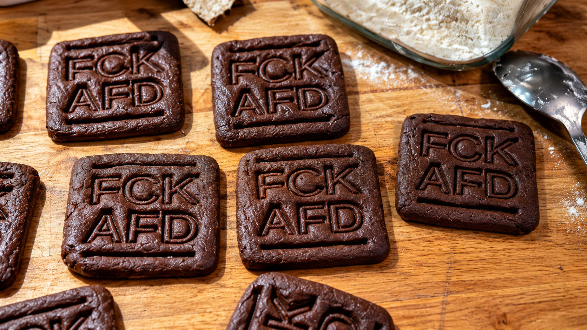

# FCK AFD – Cookie Cutter & Embosser

Parametric 3D-printable cookie cutter with an integrated, mirrored **FCK AFD** embossing design. The model was printed and successfully tested with chocolate cookie dough.

## Downloads

- **[STL – ready to slice](models/FCK_AFD_Cookie_Cutter_v7.stl)**
- **[OpenSCAD – editable parametric source](models/FCK_AFD_Cookie_Cutter_v7.scad)**
- **[Printables model page](https://www.printables.com/model/1887709-fck-afd-cookie-cutter-embosser)** – download the model there or save it to your Printables collection (an adult account/login may be required).

## Dimensions

| Property | Value |
|---|---|
| Cookie size (nominal cutting interior) | 70 × 70 mm |
| Outside size including grip rim | 78 × 78 mm |
| Overall height | 15 mm |
| Wall thickness | 1.6 mm |
| Tapered cutting edge | 0.8 mm |
| Letter outline thickness | 1.2 mm |
| Lettering | Mirrored, two lines |
| Backing | Open structure with two horizontal and two vertical supports |

## Suggested FDM print settings

- Nozzle: **0.4 mm**
- Layer height: **0.2 mm**
- Material: **PLA or PETG**, taking food-contact suitability into account
- Orientation: **grip side on build plate**
- Supports: **not required for the intended orientation**

The embossing was tested on dough approximately 6 mm thick. Results depend on dough consistency and pressing depth.

**Food-contact note:** FDM prints can retain residues in layer lines and gaps; select suitable materials and follow appropriate hygiene and cleaning practices. A standard PLA or PETG filament alone does not guarantee food-contact safety.

## License

**[CC BY-NC-SA 4.0](https://creativecommons.org/licenses/by-nc-sa/4.0/)** – Attribution, NonCommercial, ShareAlike. See [LICENSE.md](LICENSE.md).

Created by [uhrensohn86](https://github.com/uhrensohn86). Links and attribution should be retained when sharing or modifying this project.
